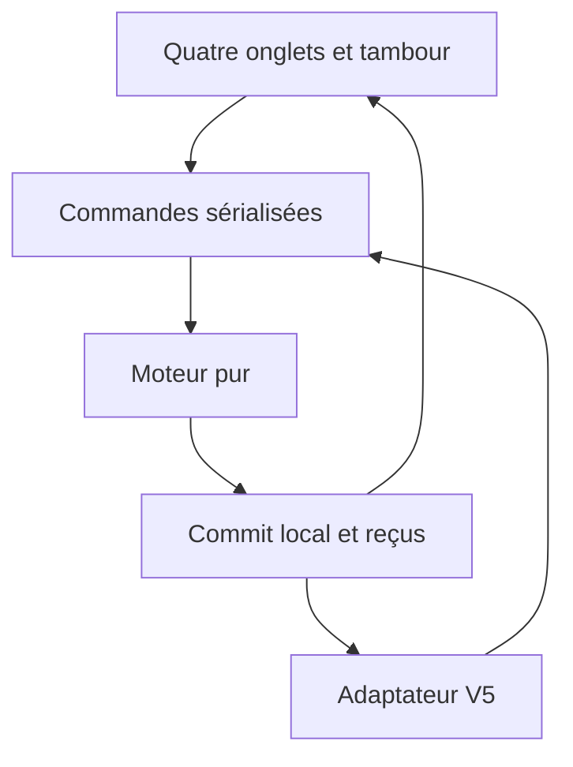

# Architecture cible (décision Lot 0, pas une implémentation)

Application statique JavaScript ES modules, HTML/CSS, sans framework ou serveur supplémentaire.
Réutiliser les algorithmes et tests ciblés des prototypes, l'organisation visuelle de Brack/Samoth,
et le protocole V5 existant. Aucun import d'exécution depuis Pilot20, Forge ou créateur.



## Arborescence proposée pour les prochains lots

```text
src/kobe/
  engine.js           validation et transition pure
  model.js            état initial, invariants et migrations
  spells.js           catalogue local ciblé
  abilities.js        Glamour, Cri, Inspiration
  khar-vek.js          règles du vestige
  effects.js          échéances, concentration, cumul
  journal.js          événements métier structurés
  storage.js          commit atomique, export, import
  connect.js          seule frontière RPG Connect
web/
  index.html
  kobe/app.js          rendu dérivé, navigation, brouillons
  kobe/kobe.css        palette et styles propres
  kobe/assets/        portrait et assets autorisés locaux
  kobe/vendor/        uniquement modules V5 retenus, provenance
  sw.js               cache complet versionné
  manifest.webmanifest
 tests/               moteur, stockage, contrats
 e2e/                 local/offline/réseau/tablette
 docs/                dossier du Lot 0 conservé
```

Cette arborescence est indicative : ne pas créer de modules vides ni appliquer un renommage global au Lot 0.
À la récupération B, extraire la façade réseau de `app.js` et retirer toute dépendance de son packaging à Pilot20.

## État et transaction

Une source d'état par personnage : profil, ressources, emplacements, économie, effets, concentration,
résolutions en attente, journal, préférences, receipts et révision. Les brouillons de cible et animations sont UI.
Les faits inconnus des alliés valent `unknown`, jamais « PV max / réaction libre » par défaut.

`dispatch` sérialise validation → calcul → écriture durable → notification. Le moteur reçoit RNG/temps explicites,
sans DOM, réseau ou localStorage. L'UI ne décrémente rien elle-même.
Un coût et ses effets sont écrits ensemble ; pas de confirmation de réussite si stockage échoue.

Persistance : commencer par le stockage JSON local existant, une enveloppe versionnée et atomique par écriture.
Export avant migration, ancienne version conservée, import validé et prévisualisé. Échec/quota = état mémoire inchangé,
message récupérable et export possible. Les snapshots d'annulation ne doivent pas embarquer récursivement leur historique.
Plusieurs onglets : un seul écrivain (verrou pris en charge et testé sur Safari, sinon second onglet en lecture seule).
Ne pas prétendre que comparer une révision localStorage fournit à lui seul une transaction inter-onglets.
Si ces garanties échouent, IndexedDB natif reste une solution locale possible, pas une nouvelle infrastructure serveur ;
justifier ce choix au Lot 1 par un test de concurrence, plutôt que l'ajouter préventivement.

## Déduplication et corrections

- UUID stable créé pour l'intention, conservé aux retries ; receipt enregistré dans la même enveloppe que l'effet.
- `(actionId, effectId, targetId)` empêche un soin/dégât multi-cibles appliqué deux fois ; rejeter même ID avec payload divergent.
- Début de tour : clé `syncEpoch/combatId/turnStartRevision/actorId` ; rejouer le snapshot n'ouvre pas une nouvelle action.
- Annulation : événement compensatoire, conserve tombstones/receipts ; aucun retour arrière du registre de déduplication.
- Ne pas purger les receipts actifs avec la limite d'affichage du journal ; archiver par session fermée avec refus des anciennes époques.
- Double frappe ne suffit pas à créer deux intentions : verrou de confirmation UI + contrôle métier.
- Corrections manuelles : valeur avant/après, raison facultative, origine joueur/MJ, révision attendue ; pas de recalcul rétroactif opaque.

## Offline et reprises

Assets, scripts et descriptions nécessaires embarqués ; premier chargement complet en ligne nécessaire pour installer le cache.
Service worker versionné, cache prêt vérifié, pas de swap de version au milieu d'une transaction.
Aucune dépendance réseau obligatoire après installation. Reprise après veille ne fait pas avancer artificiellement dix tours.
Repos courts/longs et aube sont des commandes distinctes ; temps narratif explicite, pas l'horloge du téléphone comme autorité.

## Réseau : contrat existant d'abord

Table Libre par défaut pour Kobe. Réutiliser la projection publique V5 et l'invitation existantes, sans serveur nouveau.
L'adaptateur reçoit des corrections autorisées et les convertit en commandes locales ; les snapshots du groupe ne remplacent pas le local.
Déconnexion : statut visible, état du groupe marqué périmé, combat local disponible.
Reconnexion : dernier état public seulement ; aucun replay automatique des soins, attaques ou consommations locales.
L'inscription `kobe` manque encore dans les main serveur/Encounter : coordination du Lot 4, sans dépendance pour Lots 1–3.
Le mode guidé historique n'est pas assimilé à Table Libre ; ne pas importer ses blocages réseau dans le moteur autonome.

## Réutilisation retenue et exclusions

Retenir contrats `CompanionAPI`, `RPGTable`, projection `tacticalState`, marqueurs `RPGTurnStart` après tests ciblés.
Ne pas importer en bloc les observateurs DOM, calculs de dégâts issus de texte rendu, DD nominaux ou états globaux.
La référence B peut fournir catalogue/tests, mais ses rapports « PASS » ne dispensent pas de la recette après découplage.
