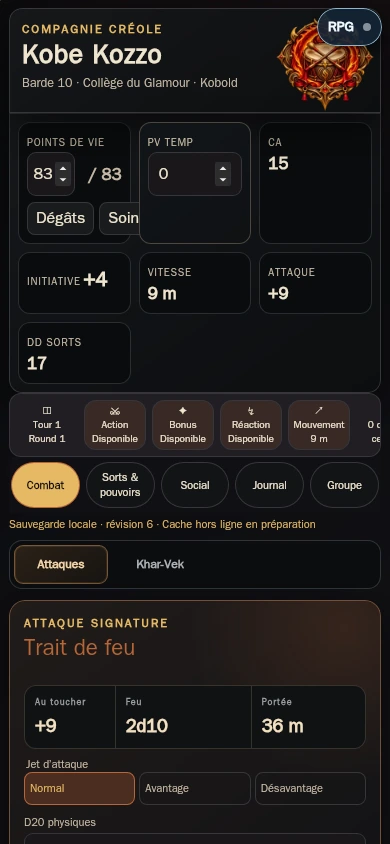
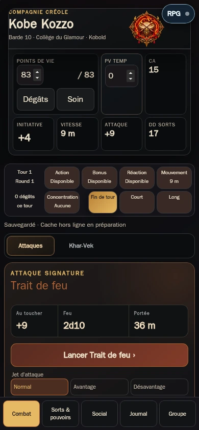
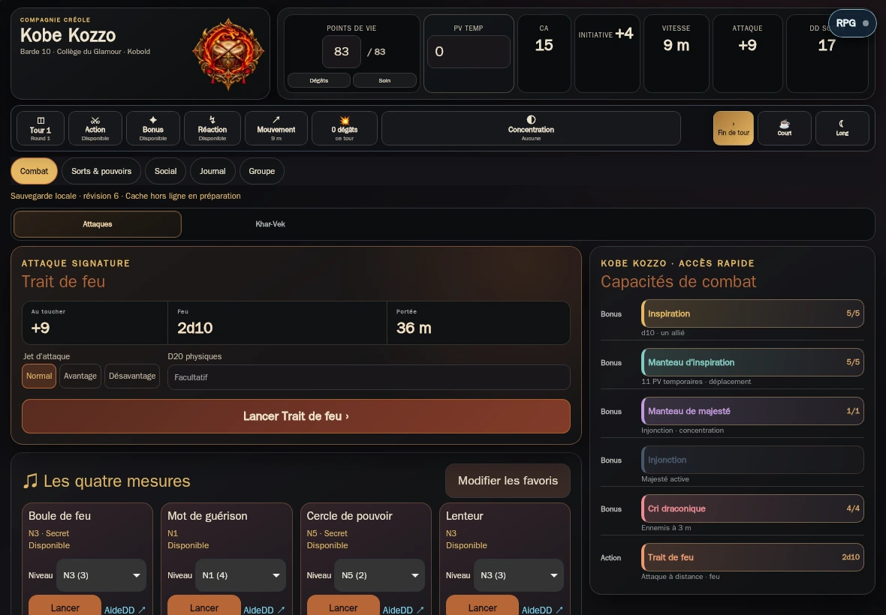
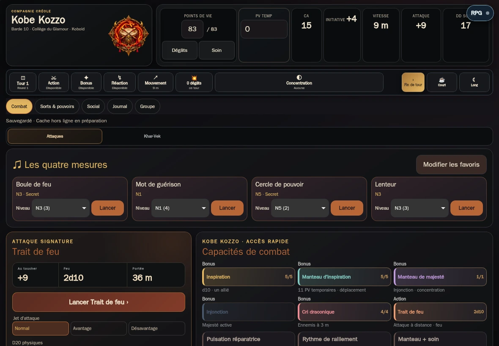
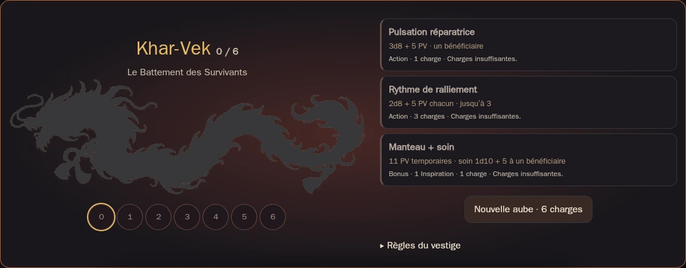
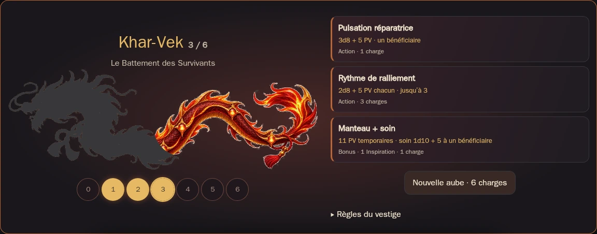
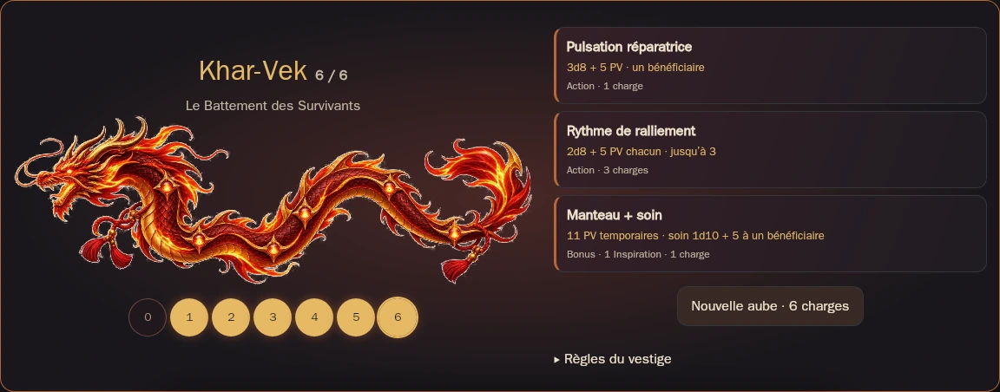

# Kobe V1.1 — livraison du 7 novembre 2026

## Point de départ

Reprise de la PR #12, branche `fix/iphone-support-console`, tête `d7a846a4d9397149d36bfa5cef4bbd9584c49173`, ouverte et fusionnable, sur main `0cdd548f10201cbdede87a654aac1209142dc862`. Les PR #10 et #11 étaient fusionnées. Aucun développement existant n’a été recommencé. Audit du 6 novembre lu intégralement ; spécification et historique consultés. Fiche Kobe et illustration du vestige vérifiées : règles et 19 sorts conservés.

La CI initiale `42301260778` était rouge : moteur/build verts, scénarios navigateur et sept clients interrompus par des attentes de commandes Combat depuis Journal ou Groupe. Les scénarios ont été corrigés pour naviguer réellement ; aucune assertion métier supprimée.

## Corrections

| Problème confirmé | Résultat de la PR finalisée |
|---|---|
| PV et PV temporaires se recouvrent sur téléphone | Grille responsive, commandes PV distinctes, boutons tactiles de 44 px |
| Fin de tour hors champ et navigation instable | Barre de tour mobile en grille, navigation basse et safe-area |
| En-tête Combat traverse tous les parcours | En-tête compact dans Sorts, Social, Journal et Groupe |
| Raccourcis Khar-Vek repoussent les favoris sur iPad | Quatre favoris prioritaires pleine largeur, capacités en grille, niveaux inline |
| Grille Social déborde à 375 px | Deux colonnes mobiles, libellés repliables et bonus distincts |
| Annuler enfoui et retour perdu au changement d’onglet | Résultat persistant, Annuler visible et associé à la transaction |
| Coût du Manteau ambigu | « Manteau + soin », bonus + 1 inspiration + 1 charge, transaction unique |
| Reprise réseau après rechargement absente | Invitation mémorisée, reprise automatique ; déconnexion explicite l’oublie |

La majorité de ces corrections avait commencé dans les deux commits de la PR #12 ; la reprise ajoute la finalisation paysage, les corrections Social et de spécificité CSS, la persistance du résultat et la recette complète. Le moteur transactionnel, les sauvegardes, le catalogue, les modules narratifs et le transport fonctionnel sont conservés.

Khar-Vek conserve le dragon existant : six sections successives du corps, silhouette grise à zéro, image entière à six. Sept corrections directes 0–6 ; trois pouvoirs accessibles en Combat et dans la console. Aucune percussion expérimentale ni formulaire de cible/nombre/contexte. Une nouvelle aube reste une commande explicite, distincte des repos. Les soins alliés et 11 PV temporaires sont annoncés à la table ; les fiches distantes ne sont pas modifiées arbitrairement.

## Captures avant / après

Même moteur WebKit, mêmes quatre favoris, même cadrage. « Avant » correspond au main audité `0cdd548` ; « après » correspond à la version finale sur main, incluant le correctif de taille de l’emblème. Il s’agit de captures de navigateur Linux, pas de photos d’appareils iOS.

| Format | Avant | Après |
|---|---|---|
| iPhone · 390 × 844 |  |  |
| iPad paysage · 1180 × 820 |  |  |

Console du vestige aux trois états de référence :

## Recette

**Résultat final : tous les contrôles disponibles réussis sur `cd2f54a7ebe8357892b305905ef65ed9c66de7f7`.** [CI finale 42348457910](https://github.com/bryantoualy-del/Kobe/actions/runs/42348457910), trois jobs verts. [Archive complète des captures, quatre formats et deux moteurs](https://github.com/bryantoualy-del/Kobe/actions/runs/42348457910/artifacts/13564806488). Le contrôle public de la version Pages précédente réussit également.

Les tests sont exécutés sur des données isolées. `npm run test:e2e` est un contrôle statique du build/cache ; il ne remplace pas les scripts Playwright. La CI exécute séparément les vrais navigateurs Chromium et WebKit Linux.

- `npm test` : 154 tests moteur, sauvegardes, confidentialité et idempotence.
- `npm run build` et `npm run test:e2e` : compilation autonome et ressources hors ligne cohérentes.
- `parity-browser` : 31 jets, avantage, sauvegardes physiques, inventaire, notes, PNJ, portrait, archives, export ZIP et géométrie mobile.
- `browser-smoke` : capacités directes, persistance, Journal et absence de formulaires de cible.
- `spellbook-browser` : 19 sorts, recherche, filtres, quatre favoris, surincantation, concentration et hors ligne.
- `kharvek-browser` : 0–6 charges, trois pouvoirs, double clic, Undo, coûts uniques, aube et reprise.
- `table-browser` : invitation, groupe, initiative, correction unique, reconnexion, reprise automatique après reload, jet privé et reçus persistants.
- `resume-browser` : profil fermé/rouvert, mise à jour du service worker, origine HTTP 503, nouveau démarrage sans origine et soin sauvegardé.
- `table-ecosystem` : Encounter réel, six applications historiques et Kobe ; sept invitations, PV 83 → 75 une seule fois et Samoth visible dans Groupe.
- `layout-browser` : avant/après sur 375, 390, 430 et 1180 × 820 ; commandes tactiles, absence de débordement, quatre favoris visibles, Undo après changement d’onglet.

Le runtime local a validé Node/build/cache et les 10 tests du serveur. Chromium local ne démarre pas (socket système refusée) et WebKit local manque de bibliothèques système. La preuve navigateur provient donc de GitHub Actions, pas d’une exécution locale ni d’un iPad physique.

## Écosystème et services

| Élément | État vérifié |
|---|---|
| RPG Connect #7 | Fusionnée, commit `5b13cd5f28e483088550cad3b2b893dde4ae2d3a` |
| Serveur utilisé par Kobe | Render `rpgconnect-mr10.onrender.com`, déploiement `dep-dbn4p3942hec73fhjaj0`, même commit, live |
| Encounter #21 | Revue, CI Encounter et V5 vertes ; fusionnée pendant cette mission en `76aa2b6594d24e4c55aa7da219c4aa421b682289` |
| Page Encounter | `https://bryantoualy-del.github.io/Encounter/` ; fichier publié `rpg-connect-mj.js` identique à la candidate testée (SHA-256 `57674a03905fedaf3da8061ecff392d882567a7f597fb34120d40524a72f1de5`) |
| Ancien service Render Encounter | `table-de-jeu.onrender.com`, déploiement `dep-dbnccg0ae00c738jqbn0`, commit `76aa2b6`, live ; son Dockerfile lance un ancien serveur, ce n’est pas la page statique du MJ |

Les tests de bout en bout utilisent un vrai serveur V5 et les vraies applications, en salle isolée. Les SHA de production sont identifiés, mais aucune salle réelle avec clé MJ n’a été manipulée. Une réponse HTTP ou un statut Render « live » ne constitue pas à lui seul une recette de jeu en production.

## Contrôles sur appareils restant à faire

- iPad Air 5, Safari, paysage : lisibilité, toucher, barre de tour, quatre favoris, Touché/Raté, Undo, puis veille et retour.
- iPhone : 375/390/430 CSS px, rotation, encoche et barre d’accueil ; vérifier les zones sûres et le clavier des notes.
- Premier chargement complet puis mode avion, fermeture réelle de Safari et réouverture : PV, charges, notes, portrait et nouvelle action sauvegardée.
- Journal : saisie rapide, clavier, export ZIP dans Fichiers et import Obsidian dans le coffre habituel.
- Avec le MJ : invitation réelle, Groupe, initiative, correction unique, coupure Wi-Fi et reconnexion ; aucun jet privé diffusé.

Playwright WebKit Linux n’est pas Safari iPadOS. Les gestes système, la pression mémoire, le clavier natif, Fichiers et Obsidian exigent cette recette matérielle.

## Version de recette

[Ouvrir la recette privée](https://kobe-v11-recette-bryan-20261107.bryantoualy.chatgpt.site). Cette origine est séparée de GitHub Pages et possède ses propres données locales. Elle permet une recette matérielle sans remplacer ni importer automatiquement la sauvegarde de l’application habituelle.

## Fusion et continuité

PR #12 fusionnée le 7 novembre en `f801d5d4fff75f8036d3228ce2526a693ba635cc`, après CI complète et revue des captures. Tête fonctionnelle `6b778f1` ; les ajouts documentaires et captures de clôture ne changent pas l’application. Aucune revue bloquante ni autre PR Kobe ouverte lors de l’inventaire final. La branche de travail est conservée.

Version de recette privée déployée avec succès, déploiement `appgdep_6aeec9f855308191ab5388b1b9ade8e8`, source statique `a84e6e4f4d5aaf8118b88e21dd3867e77736760c`, construite avec les mêmes ressources que la tête fonctionnelle. Le serveur V5 répond à `/health` avec `ok: true` et `table-free-v5`.

Publication principale : [Kobe sur GitHub Pages](https://bryantoualy-del.github.io/Kobe/), commit `cd2f54a7ebe8357892b305905ef65ed9c66de7f7`, déploiement [42348458114](https://github.com/bryantoualy-del/Kobe/actions/runs/42348458114) réussi. Le correctif post-fusion maintient l’emblème paysage à 100 px et ajoute son contrôle géométrique ; aucune mécanique n’est modifiée.

Vérification après publication : les octets de `src/ui/app.js`, `src/ui/brack.css` et `offline-shell.js` servis par GitHub Pages correspondent exactement aux fichiers finaux testés.
